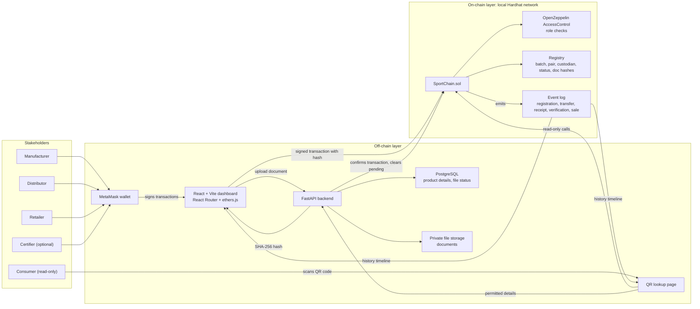
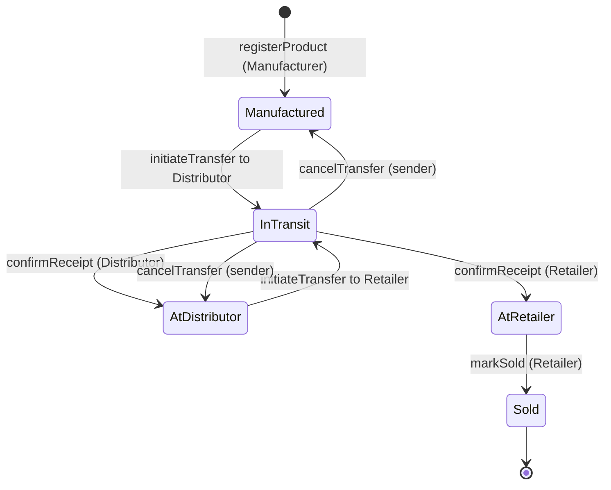

# SportChain Architecture

## System overview

## Product lifecycle

`anchorDocument` and `recordClaimVerification` can be called at any stage after
registration. They add records but do not change the status.

## Roles and permissions

| Role | Granted by | Can call |
|---|---|---|
| `DEFAULT_ADMIN_ROLE` | constructor (deployer) | `grantRole`, `revokeRole` |
| `MANUFACTURER_ROLE` | admin | `registerBatch`, `registerProduct`, `initiateTransfer` (to a distributor), `cancelTransfer`, `anchorDocument` while custodian |
| `DISTRIBUTOR_ROLE` | admin | `confirmReceipt`, `initiateTransfer` (to a retailer), `cancelTransfer`, `anchorDocument` while custodian |
| `RETAILER_ROLE` | admin | `confirmReceipt`, `markSold`, `anchorDocument` while custodian |
| `CERTIFIER_ROLE` | admin | `recordClaimVerification`, `anchorDocument` (any pair) |
| Consumer (no role) | none | all `view` functions: `getProduct`, `getBatch`, `getDocuments`, `getClaimVerifications`, `verifyDocument`, `productExists` |

## On-chain vs. off-chain data

| Data | Where | Why |
|---|---|---|
| Pair ID, batch ID, model number | On-chain | Needed to link and look up records |
| Current and pending custodian, status, timestamps | On-chain | The provenance record that must be tamper-evident |
| SHA-256 hashes of documents and claims | On-chain | Lets anyone detect a modified file |
| Full documents (shipping records, certificates) | Off-chain, private file storage | Large and possibly confidential; storing them on-chain is costly |
| Model details, descriptions, images | Off-chain, PostgreSQL | Change often; no need for tamper evidence |
| Customer or buyer information | Not stored | Privacy; the contract records only that a pair was sold |

## Document anchoring flow

1. A participant uploads a document to the FastAPI backend.
2. The backend stores it privately, computes its SHA-256 hash, and marks it `pending`.
3. The participant submits the hash with `anchorDocument` in a MetaMask-signed transaction.
4. The backend sees the `DocumentAnchored` event and marks the file `confirmed`.
5. To verify, anyone re-hashes the file and calls `verifyDocument`. A `false` result means the file was changed or never anchored.

A matching hash shows that a file has not changed since it was anchored. It does
not prove the file's claims are true, and a QR code can be copied.
