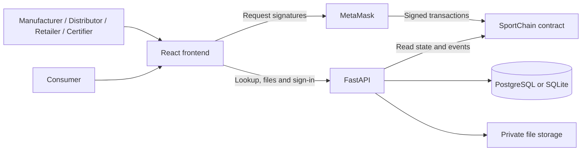

# Architecture

## Components



The contract runs on a local Hardhat chain. Deployment tooling exports its address,
ABI, chain ID, deployment block and block hash to `.runtime/deployment.json`. The
backend reads that file and serves public deployment settings at `/api/config`.
The frontend uses that configuration for wallet-signed contract calls.

Public pages read indexed history through the API. Participants sign transactions
in their wallets; the backend never signs custody changes on their behalf.

## Custody

```text
Manufactured → In transit → At distributor → In transit → At retailer → Sold
```

The sender starts each transfer and remains custodian until the named recipient
confirms receipt. The recipient must have the next stage's role both when the
transfer starts and when it is accepted. A sender can cancel an outstanding
transfer, including after its own role has been revoked.

`Sold` blocks further custody transfers and repeat sales. Documents and certifier
attestations may still be appended. Sale includes the retailer's attestation of
customer handover; the customer does not sign and no buyer identity is stored.

| Role | Permissions |
|---|---|
| Administrator | Grant and revoke roles |
| Manufacturer | Register owned batches and pairs; send pairs to distributors |
| Distributor | Accept manufacturer shipments; send pairs to retailers |
| Retailer | Accept distributor shipments; record sale and handover |
| Certifier | Anchor evidence and record claim checks for registered pairs |
| Consumer | Read public records without a wallet |

Custodians can anchor documents only while holding the role for the current
custody stage. During transit, the sender's origin stage determines that role.
Revocation preserves existing custody and history. It does not provide recovery
for lost signing keys.

## Data storage

| Data | Location |
|---|---|
| Pair/batch IDs, model number, custody, lifecycle state | Blockchain |
| Document and claim hashes, authors, timestamps | Blockchain |
| Custody history | Contract events, indexed in the database |
| Catalog descriptions | Database |
| Original model illustrations | Frontend SVG components |
| Uploaded documents | Private file storage |
| Upload metadata and exact claim manifests | Database |
| Login challenges and hashed session tokens | Database |

Pair and batch codes use Keccak-256 (`ethers.id`). Hashing predictable codes does
not hide them. File hashes use SHA-256 over the exact file bytes.

A batch's optional document hash is fixed at registration. Later evidence is
attached to individual pairs. Repeated certifier checks remain separate records;
conflicting attestations do not collapse into a single authenticity verdict.

## Authentication and documents

1. The backend issues a wallet challenge bound to the application and deployment.
2. The participant signs the message. A challenge expires after five minutes and
   can be used once; the resulting session expires after one hour.
3. The backend checks upload permission by simulating the contract's
   `anchorDocument` call with the participant's address. This also handles wallets
   with multiple organizational roles.
4. A file is stored under a generated identifier, hashed and marked `pending`.
5. The participant signs an `anchorDocument` transaction in MetaMask.
6. Synchronization marks the upload `confirmed` only when deployment, pair, hash,
   document type and uploader match the event.

Only the original uploader can download the private file. Public pages expose
on-chain hashes and metadata, not the file contents. Declined transactions leave
uploads retryable. The uploader can clean up unanchored files older than 24 hours.

Files are limited to 10 MiB. Middleware bounds the complete request before
multipart parsing, including chunked bodies. The local implementation buffers up
to the file limit plus multipart overhead per active request.

The public verification form hashes a selected file in the browser and compares
it with the pair's anchored document hashes. It does not upload the selected file.

## Event synchronization

Relevant API reads synchronize events in ranges of up to 1,000 blocks. Each event
is identified by transaction hash and log index, and a durable block checkpoint
prevents duplicate indexing. Deployment identity and checkpoint hashes detect
local chain resets and rewinds.

A new deployment invalidates old sessions and upload confirmations. Chain-derived
records are rebuilt; files from older deployments remain private and stale. RPC
failure returns an unavailable response rather than presenting cached history as
current.

Product lists read current contract state and paginate the response. This is
intended for the project's small local catalog, not production-scale inventory.

## Claim manifest encoding

A claim hash is SHA-256 over exact UTF-8 JSON bytes, without a BOM, formatting
whitespace or trailing newline. Fields appear in this order: `schema`,
`productId`, `claim`, `evidenceHashes`.

- Schema: `sportchain.claim.v1`.
- Product ID: lowercase, 0x-prefixed, 32 bytes.
- Claim text: Unicode NFC normalization.
- Evidence hashes: unique lowercase 0x-prefixed SHA-256 hashes, sorted lexicographically.

```ts
const manifest = JSON.stringify({
  schema: "sportchain.claim.v1",
  productId: productId.toLowerCase(),
  claim: claimText.normalize("NFC"),
  evidenceHashes: [...new Set(evidenceHashes.map(h => h.toLowerCase()))].sort(),
});
const claimHash = ethers.sha256(ethers.toUtf8Bytes(manifest));
```

The API preserves the exact manifest for reproduction. The contract records the
hash and certifier's result; it cannot evaluate the underlying claim.

## Operating scope

The local demo uses fictional models and simulated evidence. Public test keys are
for the local chain only. QR codes can be copied, and authorized participants can
submit false statements. A matching hash establishes file integrity, not physical
authenticity or truthfulness.

PostgreSQL is supported; SQLite is the default native development database. Schema
version 1 creates initial tables. Future schema changes require migrations.
