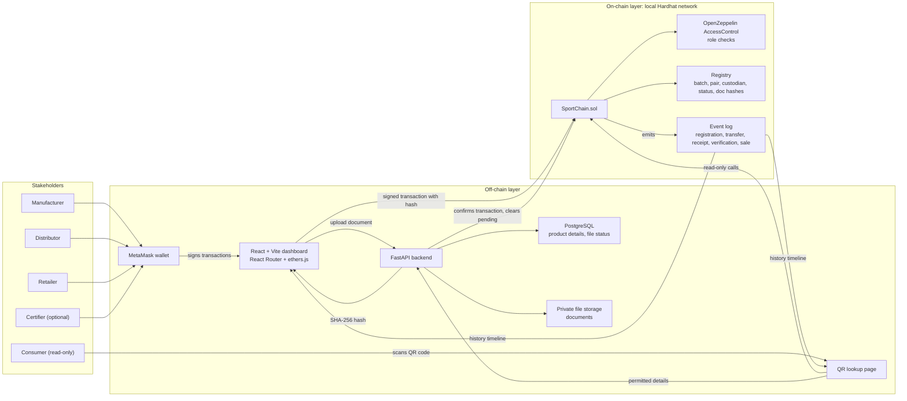
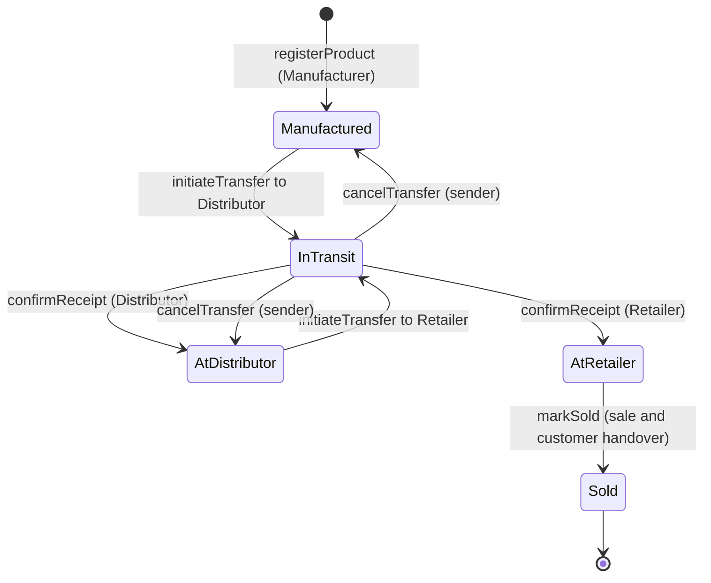

# SportChain Architecture

## System overview



## Product lifecycle



`anchorDocument` and `recordClaimVerification` can be called at any stage after
registration, including after sale, subject to the role checks below. They add
records but do not change the status. `Sold` prohibits further custody transfers
and repeated sale. `confirmReceipt` at the retailer records arrival at the store.
`markSold` combines sale and retailer-attested customer handover for this prototype;
it does not independently prove physical delivery or record consumer ownership.

## Roles and permissions

| Role | Granted by | Can call |
|---|---|---|
| `DEFAULT_ADMIN_ROLE` | constructor (`admin` argument) | `grantRole`, `revokeRole` |
| `MANUFACTURER_ROLE` | admin | `registerBatch`, `registerProduct`, `initiateTransfer` (to a distributor), `cancelTransfer`, `anchorDocument` while custodian |
| `DISTRIBUTOR_ROLE` | admin | `confirmReceipt`, `initiateTransfer` (to a retailer), `cancelTransfer`, `anchorDocument` while custodian |
| `RETAILER_ROLE` | admin | `confirmReceipt`, `markSold`, `anchorDocument` while custodian |
| `CERTIFIER_ROLE` | admin | `recordClaimVerification`, `anchorDocument` (any pair) |
| Consumer (no role) | none | all `view` functions: `getProduct`, `getBatch`, `getDocuments`, `getClaimVerifications`, `verifyDocument`, `productExists` |

Forward transfers recheck the sender's stage role. Document anchoring requires
custody plus the stage role: manufacturer at `Manufactured`, distributor at
`AtDistributor`, retailer at `AtRetailer` or `Sold`. During `InTransit`, the sender's
pre-transit stage determines the required role. Another organizational role does
not substitute for that role. Active certifiers may anchor at any registered stage.

Revocation leaves custody and historical records intact. A revoked sender may
cancel an open transfer for recovery, but must regain the appropriate role before
shipping or anchoring again (unless independently authorized as a certifier).
An active pending recipient may accept an existing shipment even if the sender's
role was revoked. Recipient roles are checked both at initiation and receipt.

## On-chain vs. off-chain data

| Data | Where | Why |
|---|---|---|
| Pair ID, batch ID, model number | On-chain | Needed to link and look up records |
| Current and pending custodian, status, timestamps | On-chain | The provenance record that must be tamper-evident |
| SHA-256 hashes of documents and claims | On-chain | Lets anyone detect a modified file |
| Full documents (shipping records, certificates) | Off-chain, private file storage | Large and possibly confidential; storing them on-chain is costly |
| Model details, descriptions, images | Off-chain, PostgreSQL | Change often; no need for tamper evidence |
| Customer or buyer information | Not stored | Privacy; the contract records only that a pair was sold |

## Document anchoring flow

1. A participant uploads a document to the FastAPI backend.
2. The backend stores it privately, computes its SHA-256 hash, and marks it `pending`.
3. The participant submits the hash with `anchorDocument` in a MetaMask-signed transaction.
4. The backend sees the `DocumentAnchored` event and marks the file `confirmed`.
5. To verify, anyone re-hashes the file and calls `verifyDocument`. A `false` result means the file was changed or never anchored.

A matching hash shows that a file has not changed since it was anchored. It does
not prove the file's claims are true, and a QR code can be copied.

## Batch records and sample data

`batchDocHash` is optional and immutable after `registerBatch`. Zero means the batch
was registered without a document hash. There is no later batch-level anchoring
API; subsequent batch evidence can be linked to each relevant pair using
`anchorDocument(productId, hash, BatchRecord)`.

IDs are Keccak-256 hashes of codes (`ethers.id`), not secret identifiers: predictable
serials can be guessed and hashed. Documents use SHA-256 over their exact file bytes.
Pair IDs, batches, certificates, claim results and custody events in tests and demos
are simulated. The planned 5–10 model catalog will cite public product descriptions
and use team-owned or appropriately licensed images; that catalog is not implemented
in this milestone.

## Claim manifest encoding

A claim hash is SHA-256 over exact UTF-8 JSON bytes, with no BOM, whitespace or trailing
newline. Construct fields in this order: `schema`, `productId`, `claim`, `evidenceHashes`.
Use schema `sportchain.claim.v1`, a lowercase 0x-prefixed 32-byte product ID, claim text
in Unicode NFC form, and unique lowercase 0x-prefixed SHA-256 evidence hashes sorted
lexicographically. Use `JSON.stringify` with these fields in order to serialize.
Preserve the resulting manifest alongside its evidence so another verifier can hash
the same bytes. Any serialization or content change produces a different hash.

```ts
const manifest = JSON.stringify({
  schema: "sportchain.claim.v1",
  productId: productId.toLowerCase(),
  claim: claimText.normalize("NFC"),
  evidenceHashes: [...new Set(evidenceHashes.map(h => h.toLowerCase()))].sort(),
});
const claimHash = ethers.sha256(ethers.toUtf8Bytes(manifest));
```

This is an off-chain encoding convention. The contract accepts a nonzero `bytes32`
and records a certifier's attestation; it cannot validate the manifest or determine
whether its claims are true. Tests use a simulated claim and evidence hash.
